# Poker opponent modeling & exploitation (offline research)

A research framework for answering one question rigorously: **how many hands of play does it
take to recognize what kind of player someone is, and how much does that help predict what they
will do next?** And once you know, **how much can you win by exploiting it, and at what risk?**

* **Phase 1** answers the first question for synthetic opponents. Simulated no-limit hold'em
  bots with known ground truth are profiled from hand histories alone.
* **Phase 2** builds the game-theoretic baseline and answers the second question exactly in
  small games. It solves Kuhn and Leduc poker with CFR variants, Deep CFR and an LP. It then
  models Leduc bots from what a player can see and exploits them with best, restricted Nash
  and data-biased responses.

Every claim is measured on held-out players across independent seeds with confidence
intervals. The repository also contains the typed skeleton that Phases 3–5 (general
framework, home-game capture, live evaluation) plug into.

> **Scope.** Offline research only: no integration with any online poker site, no scraping or
> screen reading, and no real-time assistance for real-money online play. Advice-producing code
> sits behind an information firewall enforced in code (see [Information firewall](#information-firewall)).

**New here?** [`docs/BUILD_LOG.md`](docs/BUILD_LOG.md) explains how every step was built (the
poker, the statistics, the ML and the engineering) in enough detail to rebuild the project.

## Results explorer

[`experiments/results/explorer.html`](experiments/results/explorer.html) is an interactive page
covering every result below and more. Pick a phase, then a section. The buttons above the charts
switch the model, game, sample size, opponent model, response type and bot archetype. It is one
self-contained file: download it and open it in any browser, offline.

* Every chart has a hover readout and a legend that hides or shows series.
* Every chart has a table view with the exact numbers.
* Light and dark themes are supported.

<picture>
  <source media="(prefers-color-scheme: dark)" srcset="docs/img/explorer-dark.png">
  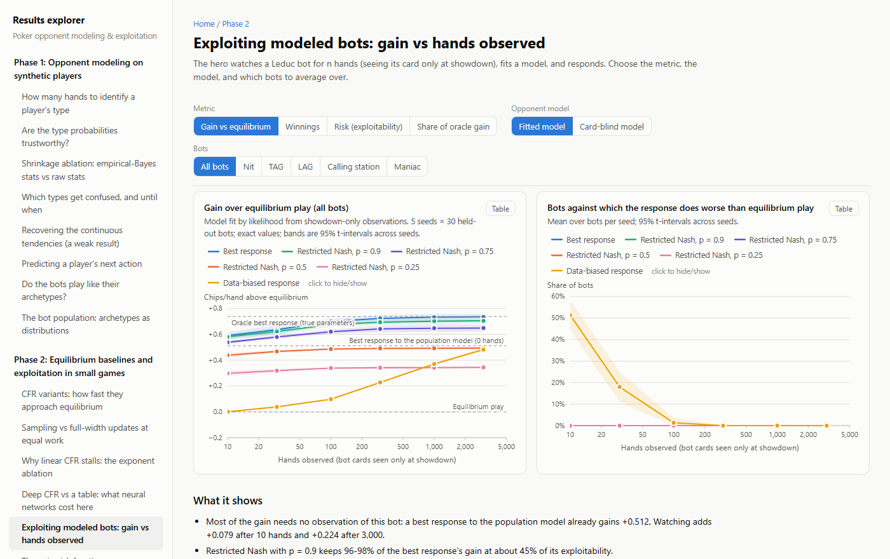
</picture>

```bash
python -m experiments.explorer                 # rebuild it (the phase runners do this after full runs)
python -m experiments.explorer.browser_check   # optional: click through every view in headless Chrome/Edge
```

Each phase adds sections as its experiments produce numbers. `tests/test_explorer.py` fails if
a results file has no section or if the committed page is out of date.

## Phase 1 results

**Setup.** Five independent replicates (seeds). Each draws 300 training and 150 held-out bots
evenly from five archetypes (nit, TAG, LAG, calling station, maniac), simulates 2,000 hands per
bot (150k hands per seed), and refits everything. Training and test bots play in *separate*
leagues, so held-out players never sat at a table with training players. Brackets are 95%
t-intervals across seeds. Reproduce with `python -m experiments.run_phase1 --seed 2026`. These
results were first produced at commit `98c6dab` and reproduced exactly at `348c4d5`
(simulation fingerprint `dbec7cdce9d0`). All numbers per
seed are in `experiments/results/phase1/phase1_results.json`, and the full tables are in
[`phase1_summary.md`](experiments/results/phase1/phase1_summary.md). Analyses marked
*post hoc* were added after seeing a first run; everything else was fixed beforehand.

### 1. How many hands to identify a player's type (the headline)

<picture>
  <source media="(prefers-color-scheme: dark)" srcset="experiments/results/phase1/hands_to_identify-dark.png">
  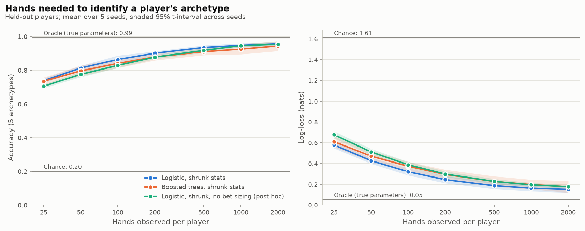
</picture>

| Hands observed | 25 | 50 | 100 | 200 | 500 | 1,000 | 2,000 |
|---|---|---|---|---|---|---|---|
| Accuracy, logistic on shrunk stats (primary) | 73.9% [72.5, 75.2] | 81.4% [80.0, 82.7] | 86.4% [84.1, 88.7] | 90.1% [89.0, 91.2] | 93.5% [92.2, 94.8] | 94.8% [93.5, 96.1] | 95.7% [95.0, 96.5] |
| Accuracy without bet-sizing features (post hoc) | 70.5% | 77.6% | 82.9% | 87.8% | 91.8% | 94.6% | 95.5% |
| Log-loss, primary (chance 1.61) | 0.58 | 0.43 | 0.32 | 0.25 | 0.19 | 0.16 | 0.15 |

* **80% accuracy after ~44 hands** (40–49 across seeds), **90% after ~194** (150–264),
  **95% after ~934** (reached in 4 of 5 seeds within 2,000 hands). With infinitely many hands
  the ceiling is 99.2% (a classifier on the true parameters), since neighboring archetypes
  overlap by design.
* **Leakage control:** retraining with labels shuffled across training players scores 19.5%
  [13.2, 25.8], i.e. chance.
* **Bet sizing is a crutch at small samples.** Bots size bets by type with little noise.
  Without sizing features, 80% takes ~68 hands and 90% ~334 (about 1.5–1.7x more). The gap
  vanishes beyond ~500 hands.
* **Simple beat complex.** Boosted trees were never better than logistic regression and had
  worse log-loss at every size (90% at ~433 hands).
* **Home-game feasibility.** At a live pace of roughly 25–35 hands an hour, 80% identification
  of a *bot* takes about 1.5–2 hours of play against it and 90% a full session. People will
  take longer (no reliable sizing tells, changing play). Profiles therefore have to accumulate
  across sessions, which `ProfileStore` does.

### 2. Calibration

<picture>
  <source media="(prefers-color-scheme: dark)" srcset="experiments/results/phase1/calibration-dark.png">
  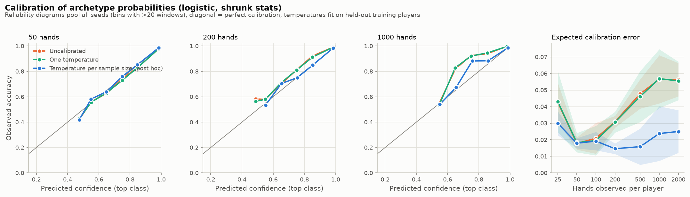
</picture>

The logistic model needs no global correction (fitted temperature 0.99 [0.92, 1.06]). Its
miscalibration depends on sample size, though: overconfident at 25 hands, underconfident from
200 hands up (reliability curves above the diagonal). A temperature per sample size (*post
hoc*; fitted from 1.24 at 25 hands down to 0.55 at 2,000) cuts expected calibration error at
200+ hands from 0.031–0.057 to 0.015–0.025. Boosted trees are overconfident (T = 1.50); scaling
cuts their ECE from 0.079 to 0.030 at 25 hands.

### 3. Shrinkage ablation: empirical-Bayes vs raw stats

<picture>
  <source media="(prefers-color-scheme: dark)" srcset="experiments/results/phase1/shrinkage_ablation-dark.png">
  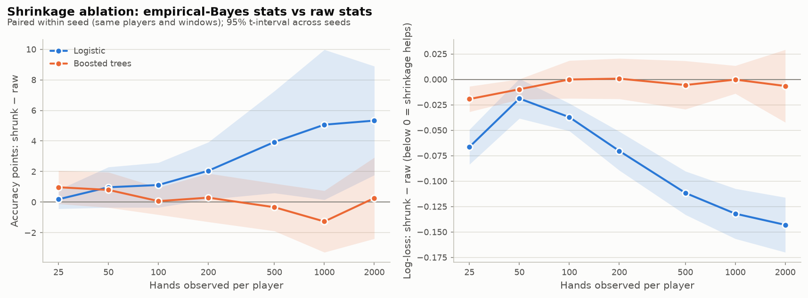
</picture>

Shrinkage clearly helps the **linear** model. Log-loss is lower at every sample size (−0.066
at 25 hands, −0.143 at 2,000), and accuracy is 2–5 points higher from 200 hands up. For
**boosted trees** the effect is indistinguishable from zero almost everywhere. The prediction
that shrinkage matters "especially at small samples" held only for log-loss at 25 hands. For
the linear model the benefit *grows* with hands. Our hypothesis (untested) is that
rare-opportunity stats stay noisy even at 2,000 hands and raw rates of exactly 0 or 1 become
extreme logits, which trees ignore and linear models do not.

### 4. Which archetypes get confused, and until when

<picture>
  <source media="(prefers-color-scheme: dark)" srcset="experiments/results/phase1/confusion-dark.png">
  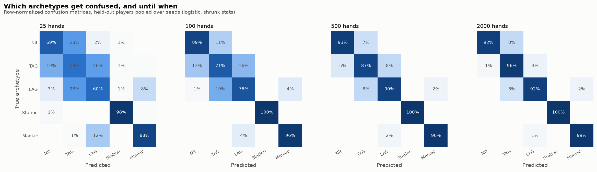
</picture>

Errors are between neighbors on the tight-loose axis: nit–TAG, TAG–LAG, LAG–maniac.
Calling stations are recognized 98% of the time after 25 hands. At 2,000 hands the remaining
errors are nit→TAG (8%) and LAG→TAG (6%), where the archetype distributions genuinely overlap.
Per-archetype recall is in [`per_class_recall.png`](experiments/results/phase1/per_class_recall.png).

### 5. Recovering the continuous tendencies (a weak result)

<picture>
  <source media="(prefers-color-scheme: dark)" srcset="experiments/results/phase1/param_regression-dark.png">
  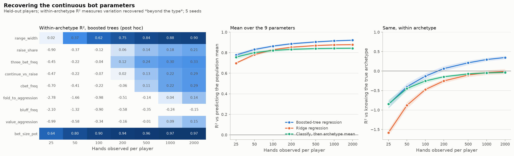
</picture>

Against the population mean, regression looks strong (mean out-of-sample R² 0.78 at 25
hands, 0.92 at 2,000). But most of that is *which archetype* a bot belongs to. Measured
**within archetype** (*post hoc*: the baseline is knowing the true type), mean R² is −0.86 at
25 hands, −0.13 at 100, +0.21 at 500 and only +0.35 at 2,000. Range width (0.90) and bet size
(0.97) are recovered individually. Fold-to-aggression (0.14), value aggression (0.15) and
**bluff frequency (−0.15)** are not, even after 2,000 hands. Those are the tendencies an
exploit would care about most, which tempers the classification result.

### 6. Predicting a player's next action (the metric Phase 5 reuses)

<picture>
  <source media="(prefers-color-scheme: dark)" srcset="experiments/results/phase1/action_prediction-dark.png">
  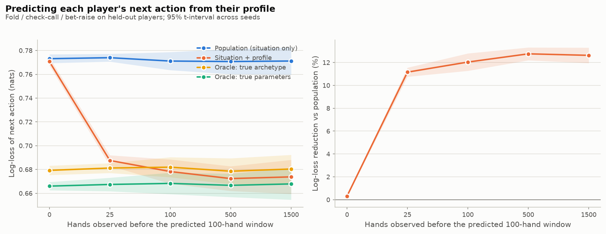
</picture>

| Hands observed before the 100-hand window | 0 | 25 | 100 | 500 | 1,500 |
|---|---|---|---|---|---|
| Log-loss, population baseline (situation only) | 0.773 | 0.774 | 0.771 | 0.771 | 0.771 |
| Log-loss, situation + profile | 0.771 | 0.688 | 0.678 | 0.672 | 0.674 |
| Reduction vs population | 0.3% [0.2, 0.4] | 11.2% [10.8, 11.6] | 12.0% [11.3, 12.8] | 12.8% [12.2, 13.3] | 12.6% [12.0, 13.3] |
| Share of the gap to the true-parameter oracle closed | 2% | 81% | 90% | 94.5% | 94% |

Fold / check-call / bet-raise is predicted for every decision of held-out players, from a
profile built only on *earlier* hands. 25 hands of history already cut log-loss by 11% and
close 81% of the gap to an oracle that knows the bot's true parameters. From 100 hands on, the
profile model beats an oracle that knows only the true archetype (0.678 vs 0.682). With zero
hands the profile carries no information, yet the model is 0.3% better than the baseline. This
is a modelling artifact (two separately fitted models), small next to the gains but reported.

### 7. Do the bots play like their archetypes? (M3 sanity check)

300 bots × 3,000 hands, measured against HUD ranges written *before* any simulation (in
parentheses). 29 of 30 cells land in range and all 4 intended orderings hold. The one miss is
marked ✗.

| Archetype | VPIP % | PFR % | 3-bet % | AF | C-bet % | Fold to c-bet % | WTSD % | W$SD % |
|---|---|---|---|---|---|---|---|---|
| Nit | 10.9 (8–16) | 6.8 (6–13) | 2.3 (1.5–5) | 2.34 (1.5–3.5) | 56.8 (45–65) | 54.0 (55–80) ✗ | 44.3 | 59.9 |
| TAG | 19.8 (17–26) | 14.4 (13–22) | 5.4 (4–9) | 2.97 (2–4) | 70.1 (60–78) | 49.4 (40–60) | 43.5 | 54.9 |
| LAG | 29.4 (26–38) | 21.8 (20–32) | 12.5 (7–14) | 3.51 (2.5–5) | 79.2 (68–85) | 41.1 (30–50) | 47.2 | 50.2 |
| Station | 44.1 (35–60) | 5.7 (3–12) | 2.6 (0.5–4) | 0.33 (0.3–1.2) | 29.3 (20–45) | 19.0 (5–25) | 70.0 | 47.4 |
| Maniac | 54.6 (45–75) | 38.8 (32–60) | 27.9 (12–30) | 3.62 (3–8) | 85.8 (75–95) | 33.1 (10–35) | 51.0 | 41.8 |

Each parameter moves the stat it is meant to (Spearman ρ across bots: range width→VPIP 0.99,
c-bet frequency→c-bet 0.97, fold-to-aggression→fold to bet 0.96, bluff frequency→aggression
0.68). Figure: [`bot_sanity_stats.png`](experiments/results/phase1/bot_sanity/bot_sanity_stats.png).
WTSD is far above typical human values, a known realism gap (see Limitations).

## Phase 2 results: equilibrium baselines and exploitation in small games

Phase 2 works on Kuhn poker (12 information sets) and Leduc hold'em (936). Both are small
enough that every strategy is evaluated **exactly**: exploitability comes from a full best
response, never from sampled play. Exploitability is NashConv / 2 in chips per hand
(OpenSpiel's convention), so 0 means an exact equilibrium and the uniform random policy scores
0.46 in Kuhn and 2.37 in Leduc. Reproduce with `python -m experiments.run_phase2 --seed 2026`
(~15 min on 16 cores). The CFR, Deep CFR and exploitation results come from commits `53eb199`,
`d09ad62` and `963cee6`. A single `run_phase2` at commit `348c4d5` reproduced every number
exactly; only wall-clock timings differ. Full tables:
[`cfr_summary.md`](experiments/results/phase2/cfr/cfr_summary.md),
[`deep_cfr_summary.md`](experiments/results/phase2/deep_cfr/deep_cfr_summary.md),
[`exploit_summary.md`](experiments/results/phase2/exploit/exploit_summary.md).

**Checked against independent references first.** The best response reproduces the published
uniform-policy NashConv (11/12 in Kuhn, 4.747222 in Leduc) and a brute force over all 64 pure
Kuhn strategies. A sequence-form LP (SciPy HiGHS) that shares no code with CFR gives the known
game values −1/18 and −0.0856064. Vectorized CFR equals a textbook recursive implementation on
both games. Everything below rests on these agreements.

### 1. CFR variants: the modern ones are ~1,000× better than vanilla CFR

<picture>
  <source media="(prefers-color-scheme: dark)" srcset="experiments/results/phase2/cfr/cfr_convergence-dark.png">
  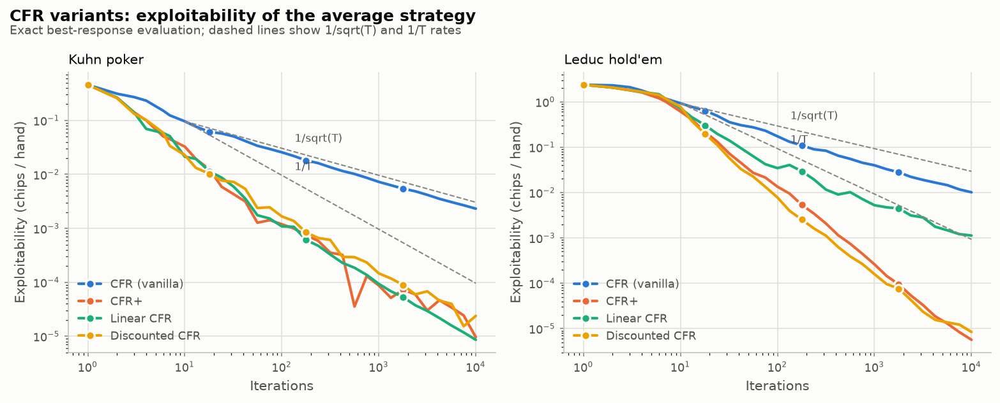
</picture>

| Leduc, exploitability after | 10 it. | 100 it. | 1,000 it. | 10,000 it. |
|---|---|---|---|---|
| CFR (vanilla) | 0.93 | 0.17 | 0.040 | 0.010 |
| CFR+ | 0.61 | 0.013 | 2.6e-4 | 5.7e-6 |
| Linear CFR | 0.72 | 0.034 | 5.2e-3 | 1.1e-3 |
| Discounted CFR (α = 1.5, β = 0, γ = 2) | 0.78 | 7.8e-3 | 1.6e-4 | 8.4e-6 |

* Vanilla CFR tracks its 1/√T rate. CFR+ and discounted CFR run faster than 1/T and finish
  1,200–1,800× below vanilla CFR on Leduc. Full-width runs are deterministic, so each curve is
  one exact run.
* **Linear CFR stalls on Leduc** at 1.1e-3, ~130× worse than DCFR. A *post hoc* ablation of
  the DCFR exponents finds the cause: negative regrets. Discarding them (β = 0, as CFR+ does)
  is worth 4–10× at α = 1 and 41–109× at α = 1.5 after 3,000 iterations. With β = 1, no
  setting of α or γ gets below 1.8e-3.
* **Sampling does not pay in games this small.** At equal work (tree nodes touched),
  external-sampling MCCFR reaches 0.041 [0.038, 0.045] on Leduc after 13.4M nodes, about 80×
  above full-width CFR+ at the same work
  ([figure](experiments/results/phase2/cfr/mccfr_vs_cfr.png)). Linear weighting does not
  help it (0.041). MCCFR is here as the sampled baseline that Deep CFR is compared with.

### 2. Deep CFR learns, but loses to a table in a game this small (a negative result)

<picture>
  <source media="(prefers-color-scheme: dark)" srcset="experiments/results/phase2/deep_cfr/deep_cfr_leduc-dark.png">
  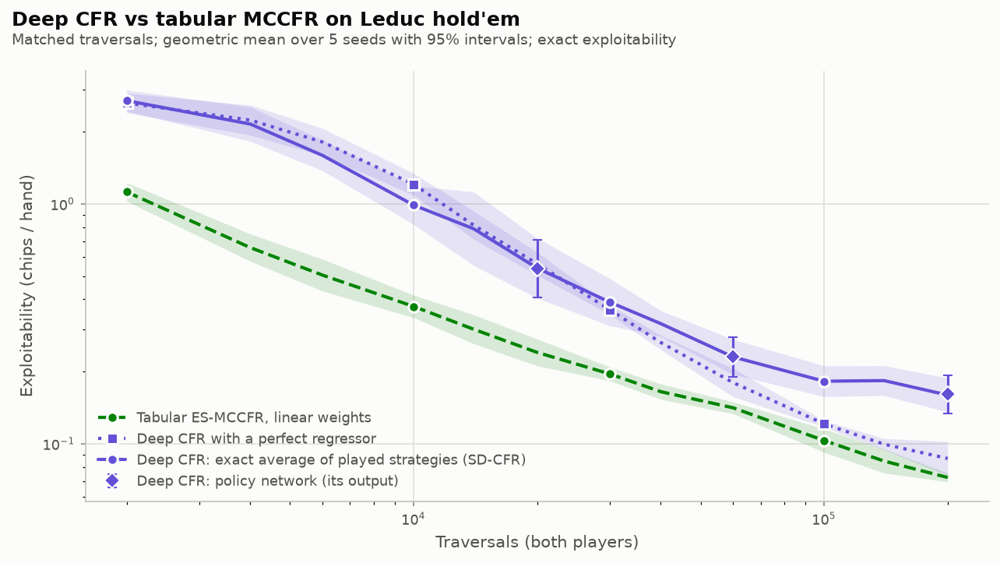
</picture>

| Leduc, exploitability after | 20,000 traversals | 60,000 | 200,000 |
|---|---|---|---|
| Tabular ES-MCCFR, linear weights | 0.240 [0.211, 0.273] | 0.141 [0.133, 0.150] | 0.072 [0.069, 0.075] |
| Deep CFR with a perfect regressor (ablation) | 0.563 [0.504, 0.628] | 0.180 [0.157, 0.206] | 0.087 [0.074, 0.102] |
| Deep CFR: policy network (its output) | 0.537 [0.408, 0.707] | 0.230 [0.190, 0.278] | 0.161 [0.134, 0.193] |

Deep CFR (Brown et al., 2019) in PyTorch: advantage networks (3×64 MLP, 11k parameters)
retrained from scratch every iteration on reservoir-sampled memories, then a policy network
distilled from the strategy memory. It is compared with tabular external-sampling MCCFR at
matched traversals over 5 seeds (geometric means, 95% t-intervals on the log scale).

* Deep CFR learns (2.37 → 0.16) but ends **2.2× more exploitable** than the table. Its curve
  flattens after ~50 iterations while the table keeps improving.
* A **perfect-regressor ablation** replaces each network with the exact minimizer of its
  training loss. It splits the gap into a cost of batching and sampled targets (×1.2,
  0.072 → 0.087) and a cost of function approximation (×1.85, 0.087 → 0.161).
* Distillation is free: the policy network matches the exact average of the strategies Deep
  CFR played (0.161 vs 0.160).
* This is the expected outcome. Leduc has only 288 strategically distinct information sets, so
  a table is already exact. Deep CFR's case is generalization in games too large for tables,
  which this experiment does not test. Its training budget was tuned on a separate development
  seed, never on reporting seeds.

### 3. Exploiting modeled opponents: large gains, mostly from the population prior

**Setup.** Leduc bots from five archetypes (nit, TAG, LAG, calling station, maniac) with five
interpretable parameters tied to hand-strength buckets. The hero sees a bot's card only at
showdown, the Leduc analog of the information firewall. The model is fit by exact marginal
likelihood over the unseen cards, with an empirical-Bayes prior fit on a separate training
population. The hero then responds with a best response (BR), a restricted Nash response
(RNR, Johanson et al., 2007), or a data-biased response (DBR, Johanson & Bowling, 2009). The
last two are solved exactly as sequence-form LPs. 5 seeds × 30 held-out bots. **Gain** is chips
per hand won above the equilibrium strategy against the same bot. Equilibrium play already wins
+0.277 per hand from these bots, so they are very exploitable.

<picture>
  <source media="(prefers-color-scheme: dark)" srcset="experiments/results/phase2/exploit/exploit_by_sample_size-dark.png">
  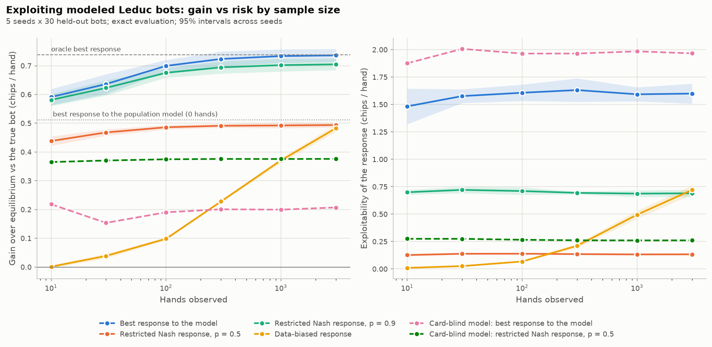
</picture>

| Hands observed | 0 (population model, *post hoc*) | 10 | 100 | 1,000 | 3,000 | Oracle (true parameters) |
|---|---|---|---|---|---|---|
| BR: gain | +0.512 [0.503, 0.522] | +0.591 [0.563, 0.619] | +0.700 | +0.734 | +0.736 | +0.738 |
| BR: exploitability | 0.97 | 1.48 | 1.61 | 1.59 | 1.60 | 1.58 |
| RNR, p = 0.9: gain | +0.508 | +0.581 | +0.675 | +0.702 | +0.705 | +0.706 |
| RNR, p = 0.9: exploitability | 0.45 | 0.70 | 0.71 | 0.69 | 0.69 | 0.69 |
| DBR: gain | | +0.001 | +0.098 | +0.371 | +0.483 | |
| DBR: exploitability | | 0.010 | 0.068 | 0.496 | 0.721 | |

* **Most of the gain needs no observation of this opponent.** The first run looked too good,
  so we added a *post hoc* control. A best response to the population's average bot, with
  zero hands observed, already gains +0.512. Watching the individual adds +0.079
  [0.057, 0.101] after 10 hands and +0.224 [0.201, 0.247] after 3,000. The pre-registered
  numbers did not change on the rerun.
* **Restricted Nash responses buy most of the gain for a fraction of the risk.** RNR with
  p = 0.9 keeps 96–98% of the best response's gain at 43–47% of its exploitability. With
  p = 0.5 it keeps 67–74% of the gain at under 9% of the exploitability.
* **The data-biased response is cautious by design.** It trusts the model only where the hero
  has seen the bot act, so after 10 hands it barely leaves equilibrium (+0.001). It catches up
  only at 3,000 hands (+0.483). Against a correctly specified model that caution is pure cost.
* **A wrong model makes the best response dangerous** (*post hoc*). A card-blind model (three
  action frequencies that ignore hand strength) is fit to the same hands. Its best response
  gains only +0.15 to +0.22 on average, loses to plain equilibrium play against 33–44% of the
  bots, and is exploitable for ~2 chips per hand. An RNR with p = 0.5 on the same wrong model
  gains +0.37 (1.7–2.4× as much) at an exploitability of about 0.26.

<picture>
  <source media="(prefers-color-scheme: dark)" srcset="experiments/results/phase2/exploit/exploit_frontier-dark.png">
  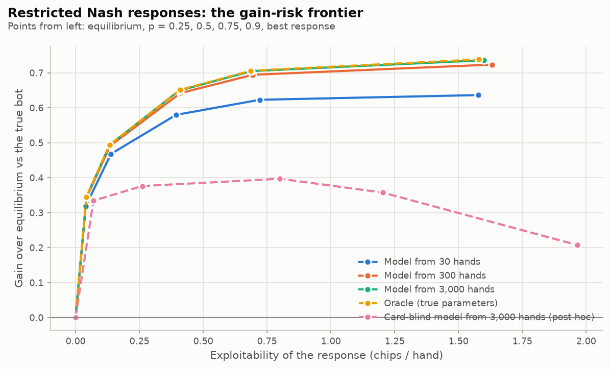
</picture>

**What Phase 2 does not show.**

* The bots follow the same five-parameter family the model fits, so apart from the card-blind
  control the model is correctly specified. The gains are an upper bound for opponents who do
  not play by the model's rules.
* The bots are very exploitable (1.0 chip per hand on average, against 2.37 for uniform random
  play) and they do not adapt when exploited.
* Values are exact expectations. At a real table a strategy is judged from sampled results
  with large variance. Duplicate dealing (`engine/duplicate.py`) is built and tested for that,
  and Phase 5 will use it.
* Leduc is not hold'em. Carrying these methods to no-limit hold'em needs an abstraction
  (Phase 3).

## Phase 3 (in progress): a bridge to hold'em

Phase 3 turns hand histories into ranked exploit recommendations. Its first step carries the
Phase 2 solvers to real hold'em with heads-up push/fold. The small blind goes all-in or
folds, and the big blind calls or folds; blinds are 0.5/1 with no ante and stacks of 1–20 bb.
The game is built over the 169 starting-hand classes:

* card-removal deal probabilities are exact;
* the 169×169 matchup equities are Monte Carlo, with 50,000 boards per pair and standard
  error ≤ 0.002.

It has 143k nodes and 338 information sets, and the Phase 2 LP and CFR solve it unchanged.
Reproduce with `python -m experiments.run_phase3 --seed 2026` (1 min). Results come from
commit `3aa83c2`; see
[`pushfold_summary.md`](experiments/results/phase3/pushfold/pushfold_summary.md).

<picture>
  <source media="(prefers-color-scheme: dark)" srcset="experiments/results/phase3/pushfold/pushfold_chart-dark.png">
  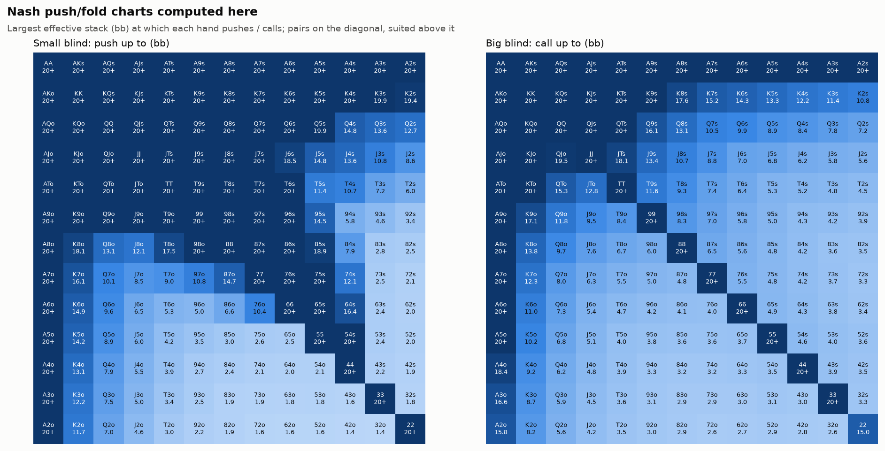
</picture>

* **It matches a published Nash solution.**
  * For calls, all 169 per-hand thresholds are within 0.1 bb of HoldemResources' no-ante
    chart, which is the chart's own resolution.
  * For pushes, 151/169 are within 0.1 bb and 158/169 within 0.25 bb. The rest are hands
    that are nearly indifferent between pushing and folding (EV difference ≤ 0.014 bb).
    Following the published chart wherever the two differ would cost at most 0.21 mbb per
    hand.
* **Independent checks agree.**
  * An exact best response finds every LP solution unexploitable, to 10⁻¹⁵.
  * CFR+ makes the same decision for all 169 hands at 5, 10 and 20 bb.
  * Every hand satisfies the per-hand equilibrium condition, computed from the matchup table
    alone.
* **A first finding:** ranking hands by equity against a random hand is nearly right. Played
  with Nash's range *sizes*, it is exploitable for at most 0.013 bb/hand. Fixed sizes such
  as "push 20%, call 10%" are exploitable for up to 0.56 bb/hand. The size of the range
  matters far more than which hands are in it.
* **A correction to the reference:** the first automated read of the published chart had five
  wrong cells. A second read fixed them, and the corrections are logged in
  `experiments/references/hune_no_ante.json`.

**Modeling and exploiting push/fold opponents (P3.2).** Simulated bots push or call the top
*w*% of hands, with a soft edge. Five archetypes sit on both sides of the equilibrium. The
hero watches a bot for *n* hands at 10 bb, seeing its cards only when a push is called, and
fits one of two models:

* a likelihood model that uses the shown cards, with an exact marginal over hidden ones;
* a frequency model that uses push and call rates only, like a HUD.

It then responds with the Phase 2 engines. The setup is 5 seeds × 30 held-out bots with
exact values (commit `a8ea075`; [`exploit_summary.md`](experiments/results/phase3/exploit/exploit_summary.md)).

<picture>
  <source media="(prefers-color-scheme: dark)" srcset="experiments/results/phase3/exploit/exploit_gain-dark.png">
  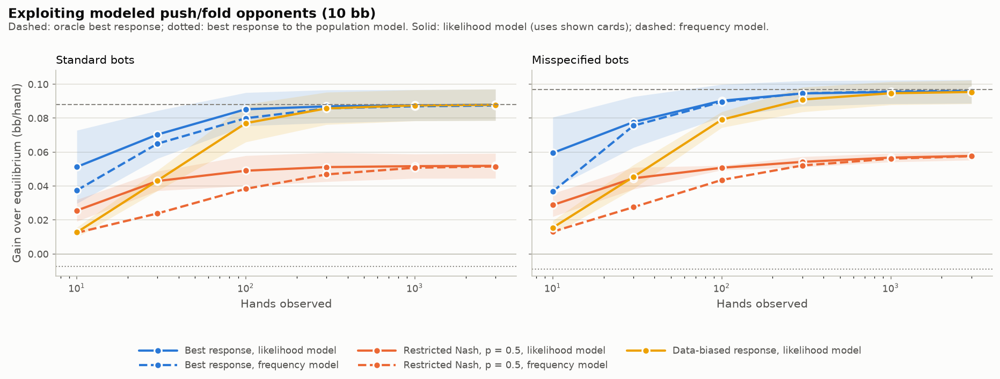
</picture>

* **The reverse of the Leduc result.** A best response to the population's average bot
  *loses* to equilibrium play (−0.007 bb/hand), because the archetypes straddle the
  equilibrium. Watching the individual pays. The best response reaches 58% of the oracle's
  gain (+0.088 bb/hand) after 10 hands, 80% after 30 and 97% after 100.
* **Shown cards help early, then frequencies catch up.** After 10 hands the gain is +0.051
  vs +0.038 bb/hand; from about 300 hands the two models are equal. Range sizes are what
  matter.
* **Hedge while uncertain.** After 10 hands the best response loses to equilibrium against
  26% of bots. Restricted Nash with p = 0.9 gains as much at 55% of the exploitability.
* **A weak control, reported as such.** Against bots that rank hands "pairs first", which
  both models assume wrongly, the best response still captures 99% of the oracle's gain. But
  the two hand orders are close (rank correlation 0.95), so this shows that range size
  dominates, not that misspecification is harmless.

Next: advice for real hold'em hands behind the firewall (P3.3), then ranked recommendations
with confidence (see [PROGRESS.md](PROGRESS.md)).

## Quickstart

Requires Python ≥ 3.11 (developed on 3.13, Windows 11).

```bash
pip install -e ".[dev]"          # numpy, pandas, scipy, scikit-learn, matplotlib, pyyaml, pokerkit, phevaluator
pip install -e ".[dev,nn]"       # adds PyTorch (CPU is enough) for Deep CFR
python -m pytest                 # full test suite
python -m ruff check .           # lint

# Reproduce every Phase 1 experiment from one master seed
python -m experiments.run_phase1 --seed 2026          # full run: 5 seeds x 150k hands, ~11 min on 16 cores
python -m experiments.run_phase1 --seed 2026 --quick  # smoke test, ~1 min (not for reporting)

# Reproduce every Phase 2 experiment (Deep CFR is skipped if PyTorch is missing)
python -m experiments.run_phase2 --seed 2026          # ~15 min on 16 cores
python -m experiments.run_phase2 --seed 2026 --quick  # smoke test, ~30 s
python -m experiments.run_phase2 --seed 2026 --only exploit   # one step: cfr, deep_cfr or exploit

# Phase 3 so far: heads-up push/fold solved exactly and checked against a published chart
python -m experiments.run_phase3 --seed 2026          # ~1 min
python -m poker_lab.games.preflop                     # optional: regenerate the matchup table (~5 min)
```

Outputs go to `experiments/results/phase1/` and `experiments/results/phase2/{cfr,deep_cfr,exploit}/`.
Each step writes a JSON file with every number (per seed and aggregated, plus seed, config, git
commit, dirty flag and package versions), a markdown summary, and figures in light and `-dark`
variants. Phase 1's simulated hands are cached in `experiments/cache/` (git-ignored) so
analyses can be re-run without re-simulating.

## How it fits together

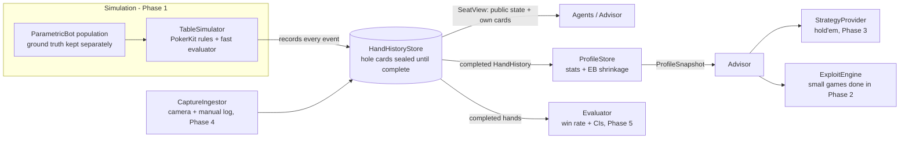

* **`schema/`**: the contract between phases. A canonical `HandHistory` (table, seats,
  positions, stacks, blinds/antes, per-card `source` + `confidence`, ordered actions by street,
  showdown, pot awards vs. uncalled returns, status), strict JSON Lines serialization, and deep
  validation (betting-sequence consistency, chip conservation, card uniqueness).
* **`engine/`**: `TableSimulator` wraps [PokerKit](https://github.com/uoftcprg/pokerkit) (MIT),
  which enforces the rules (min-raise and reopening rules, all-ins, side pots). Its pure-Python
  showdown evaluator was ~80% of runtime, so a
  [phevaluator](https://github.com/HenryRLee/PokerHandEvaluator)-backed hand type (Apache-2.0)
  is plugged into PokerKit's `hand_types` extension point. Every simulated hand is replayed
  through *unmodified* PokerKit in the tests, with identical payoffs.
* **`bots/`**: `ParametricBot` with 9 interpretable tendencies (range width, raise share,
  3-bet frequency, continue-vs-raise, c-bet frequency, fold-to-aggression, bluff frequency,
  value aggression, bet size). Five archetypes (nit, TAG, LAG, calling station, maniac) are
  *distributions* over these, so populations vary within types and neighbors overlap.
* **`profiling/`**: stats with explicit opportunity counting (VPIP, PFR, 3-bet, AF, c-bet,
  fold to c-bet, WTSD, W$SD, plus fold to 3-bet, fold to bet, bet and open sizes),
  empirical-Bayes shrinkage, a calibrated archetype classifier, parameter regression,
  public-information decision points and a next-action model, and `ProfileStore`.
* **`games/`** (Phase 2): Kuhn and Leduc behind one `Game` interface, compiled to flat
  breadth-first arrays so that strategy values, reach probabilities and best responses are
  vectorized NumPy passes over tree levels. Also `TabularPolicy`, exact best response and
  exploitability, and Leduc archetype bots with exact likelihood fitting.
* **`solvers/`** (Phase 2): sequence-form LP (exact reference), CFR / CFR+ / linear / discounted
  CFR, external-sampling MCCFR, Deep CFR (PyTorch), and restricted Nash and data-biased
  responses as LPs.
* **`exploit/`**: exploit engines. For small games they are exact and take a `TabularPolicy`
  model. For hold'em they are interfaces and heuristic stubs (Phase 3).
* **`strategy/`, `evaluation/`, `advisor/`, `capture/`**: the Phase 3–5 interfaces with
  docstrings, minimal implementations, and contract tests. `engine/duplicate.py` plays
  duplicate matches (same cards, seats swapped) for low-variance evaluation.

## Information firewall

Advice may only depend on public information, the hero's own hole cards, and profiles built
from **completed** hands. This is enforced in code, not by convention:

1. A `HandHistory` with status `in_progress` **cannot hold hole cards** (rejected at construction
   and at JSON decoding).
2. While a hand is being played, hole cards live in a private vault inside `HandHistoryStore`.
   The only read path is `store.seat_view(hand_id, seat_key)`: the identity-compared `SeatKey`
   issued at deal time unlocks *that seat's own* cards, and only `complete_hand` releases the
   rest.
3. Decision-making code only ever receives a `SeatView`: public state plus exactly one seat's
   two cards. It is frozen and slotted, and its constructor demands exact types, so a full hand
   history, a PokerKit `State`, a subclass with extra fields, or a `str` subclass carrying hidden
   attributes are all rejected.
4. `Advisor.advise(view, profiles)` accepts exactly a `SeatView` and a `ProfileSnapshot`, and
   refuses snapshots built from the hand being played. `ProfileStore` refuses in-progress
   hands.
5. Tests (`tests/test_store_sealing.py`, `tests/test_advisor_firewall.py`) attempt each
   violation and walk the object graph reachable from every advisor input, asserting that no
   other player's card is reachable.

Limit, stated plainly: in-process Python can always defeat such measures with reflection. The
firewall guards against accidental leakage and honest-but-buggy code, not a malicious caller.

## Limitations and threats to validity

Synthetic bots are easier to profile than people, and these results are an optimistic upper
reference for the home-game phase, not a forecast. Specifically:

* **Stationary, non-adaptive opponents.** Each bot plays one fixed strategy for its whole
  history. People adapt to opponents, tilt, and change gears, so their stats drift and old
  hands are less informative.
* **Stereotyped sizing.** A bot's bet sizes are tied to its archetype with little noise, which
  makes sizing a strong "tell" (quantified in the no-sizing ablation above).
* **A five-type taxonomy is a modeling choice.** Bots are drawn from five archetype
  distributions, so the classifier's probabilities over five types are meaningful here by
  construction. Real players form a continuum, and the parameter regression results are the
  more transferable part.
* **Simplified postflop play.** Bots judge strength by equity against a random hand and go to
  showdown more than typical human regulars (WTSD ~44–51% vs ~25–35%; stations ~70%).
* **No distribution shift.** Test players come from the same archetype mix as training players.
  A real table's mix (and its priors) will differ, so priors and calibration should be re-fit
  on real data (Phase 3).
* **Fixed environment.** 6-max, 100 bb stacks reset every hand, no rake, blinds 1/2.
* **Analysis choices made after seeing results are labeled *post hoc*.** The primary model and
  pre-registered metrics were fixed before the reported run; see PROGRESS.md.

## Repository layout

```
poker_lab/
  schema/      hand-history model, sealed store, firewalled views, JSONL, validation
  engine/      PokerKit wrapper, Agent interface, fast hand type, replay checker, duplicate matches
  bots/        parameterized bots, archetypes, hand strength, league simulator
  profiling/   stats, shrinkage, features, classifier, regression, action model, ProfileStore
  games/       Kuhn, Leduc, heads-up push/fold hold'em, preflop matchups, tree compiler,
               TabularPolicy, best response, Leduc bots + fitting
  solvers/     LP, CFR family, MCCFR, Deep CFR, restricted Nash / data-biased responses
  strategy/    StrategyProvider + baselines for hold'em         (Phase 3)
  exploit/     exact small-game exploit engines; hold'em ExploitEngine + stubs (Phase 3)
  evaluation/  metrics, intervals, win-rate Evaluator, duplicate/AIVAT hooks (Phase 5)
  advisor/     firewalled Advisor + AdvisorAgent                (Phase 3/4)
  capture/     CaptureIngestor: camera + manual logs -> HandHistory (Phase 4)
experiments/   run_phase1/2/3.py (one command each), configs/, results/, references/
  explorer/    builds results/explorer.html (one section per quantified result, all phases)
tests/         unit, contract, firewall, differential and end-to-end tests
docs/          BUILD_LOG.md: how every step was built, with the math
PROGRESS.md    living checklist, decisions log, open questions
```

## Roadmap

| Phase | Goal | What exists now |
|---|---|---|
| 1 | Opponent modeling on synthetic players | **Done**: this README |
| 2 | GTO baseline (CFR / Deep CFR on Kuhn and Leduc), exploit strategies, exploitability measurement | **Done** for small games: this README. Hold'em-scale exploitability (local best response) is a stretch task |
| 3 | General framework: hand histories → profiles → type estimates with confidence → ranked exploit recommendations | **In progress**: push/fold solved exactly (P3.1); push/fold opponents modeled and exploited (P3.2). Also `ProfileStore`, calibrated classifier, `Advisor` |
| 4 | Home-game capture: camera card recognition + manual action entry → hand histories | `CaptureIngestor` (fusion, typed conflicts, PokerKit replay check), `source`/`confidence` per card |
| 5 | Live evaluation: action-prediction accuracy and win rate with variance reduction | action-prediction metric (reused as-is), `WinRateEvaluator`, duplicate-deal estimator, AIVAT hook |

Concrete next tasks are tracked in [PROGRESS.md](PROGRESS.md) (section *Future*).

## Development

* Tests: `python -m pytest` (252 tests, ~1 min: unit, contract, firewall, differential-vs-PokerKit,
  solver-vs-reference, explorer and end-to-end tests; the Deep CFR tests skip without PyTorch).
  Lint/format: `python -m ruff check .` and `python -m ruff format .`.
* Every results file records the seed, the full config, the git commit, whether the working
  tree was dirty, and package versions. Experiments are reproducible from the master seed:
  simulation seeds are derived with `numpy.random.SeedSequence`, cards are dealt from seeded
  RNGs, and results do not depend on the number of worker processes (tested).
* Decisions and their rationale are logged in [PROGRESS.md](PROGRESS.md).
