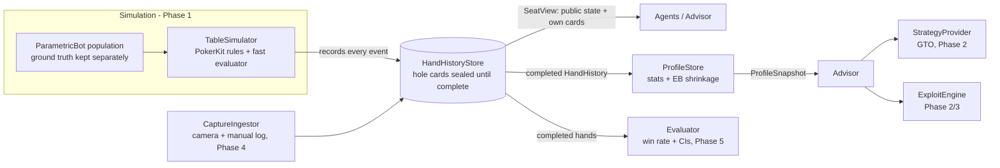

# Poker opponent modeling & exploitation (offline research)

A research framework for answering one question rigorously: **how many hands of play does it
take to recognize what kind of player someone is, and how much does that help predict what they
will do next?** Phase 1, implemented here, answers it for synthetic opponents. Simulated
no-limit hold'em bots with known ground truth are profiled from hand histories alone, and every
claim is measured on held-out players across independent seeds with confidence intervals.

The repository also contains the typed skeleton that Phases 2–5 (GTO baseline, exploitation,
home-game capture, live evaluation) plug into, so later phases are drop-in additions.

> **Scope.** Offline research only: no integration with any online poker site, no scraping or
> screen reading, and no real-time assistance for real-money online play. Advice-producing code
> sits behind an information firewall enforced in code (see [Information firewall](#information-firewall)).

**New here?** [`docs/BUILD_LOG.md`](docs/BUILD_LOG.md) explains how every step was built (the
poker, the statistics, the ML and the engineering) in enough detail to rebuild the project.

## Phase 1 results

**Setup.** Five independent replicates (seeds). Each draws 300 training and 150 held-out bots
evenly from five archetypes (nit, TAG, LAG, calling station, maniac), simulates 2,000 hands per
bot (150k hands per seed), and refits everything. Training and test bots play in *separate*
leagues, so held-out players never sat at a table with training players. Brackets are 95%
t-intervals across seeds. Reproduce with `python -m experiments.run_phase1 --seed 2026`; these
results come from commit `98c6dab` (simulation fingerprint `7799e1e5ceac`). All numbers per
seed are in `experiments/results/phase1/phase1_results.json`, and the full tables are in
[`phase1_summary.md`](experiments/results/phase1/phase1_summary.md). Analyses marked
*post hoc* were added after seeing a first run; everything else was fixed beforehand.

### 1. How many hands to identify a player's type (the headline)

<picture>
  <source media="(prefers-color-scheme: dark)" srcset="experiments/results/phase1/hands_to_identify-dark.png">
  
</picture>

| Hands observed | 25 | 50 | 100 | 200 | 500 | 1,000 | 2,000 |
|---|---|---|---|---|---|---|---|
| Accuracy, logistic on shrunk stats (primary) | 73.9% [72.5, 75.2] | 81.4% [80.0, 82.7] | 86.4% [84.1, 88.7] | 90.1% [89.0, 91.2] | 93.5% [92.2, 94.8] | 94.8% [93.5, 96.1] | 95.7% [95.0, 96.5] |
| Accuracy without bet-sizing features (post hoc) | 70.5% | 77.6% | 82.9% | 87.8% | 91.8% | 94.6% | 95.5% |
| Log-loss, primary (chance 1.61) | 0.58 | 0.43 | 0.32 | 0.25 | 0.19 | 0.16 | 0.15 |

* **80% accuracy after ~44 hands** (40–49 across seeds), **90% after ~194** (150–264),
  **95% after ~934** (reached in 4 of 5 seeds within 2,000 hands). With infinitely many hands
  the ceiling is 99.2% (a classifier on the true parameters), since neighboring archetypes
  overlap by design.
* **Leakage control:** retraining with labels shuffled across training players scores 19.5%
  [13.2, 25.8], i.e. chance.
* **Bet sizing is a crutch at small samples.** Bots size bets by type with little noise.
  Without sizing features, 80% takes ~68 hands and 90% ~334 (about 1.5–1.7x more). The gap
  vanishes beyond ~500 hands.
* **Simple beat complex.** Boosted trees were never better than logistic regression and had
  worse log-loss at every size (90% at ~433 hands).
* **Home-game feasibility.** At a live pace of roughly 25–35 hands an hour, 80% identification
  of a *bot* takes about 1.5–2 hours of play against it and 90% a full session. People will
  take longer (no reliable sizing tells, changing play). Profiles therefore have to accumulate
  across sessions, which `ProfileStore` does.

### 2. Calibration

<picture>
  <source media="(prefers-color-scheme: dark)" srcset="experiments/results/phase1/calibration-dark.png">
  
</picture>

The logistic model needs no global correction (fitted temperature 0.99 [0.92, 1.06]). Its
miscalibration depends on sample size, though: overconfident at 25 hands, underconfident from
200 hands up (reliability curves above the diagonal). A temperature per sample size (*post
hoc*; fitted from 1.24 at 25 hands down to 0.55 at 2,000) cuts expected calibration error at
200+ hands from 0.031–0.057 to 0.015–0.025. Boosted trees are overconfident (T = 1.50); scaling
cuts their ECE from 0.079 to 0.030 at 25 hands.

### 3. Shrinkage ablation: empirical-Bayes vs raw stats

<picture>
  <source media="(prefers-color-scheme: dark)" srcset="experiments/results/phase1/shrinkage_ablation-dark.png">
  
</picture>

Shrinkage clearly helps the **linear** model. Log-loss is lower at every sample size (−0.066
at 25 hands, −0.143 at 2,000), and accuracy is 2–5 points higher from 200 hands up. For
**boosted trees** the effect is indistinguishable from zero almost everywhere. The prediction
that shrinkage matters "especially at small samples" held only for log-loss at 25 hands. For
the linear model the benefit *grows* with hands. Our hypothesis (untested) is that
rare-opportunity stats stay noisy even at 2,000 hands and raw rates of exactly 0 or 1 become
extreme logits, which trees ignore and linear models do not.

### 4. Which archetypes get confused, and until when

<picture>
  <source media="(prefers-color-scheme: dark)" srcset="experiments/results/phase1/confusion-dark.png">
  
</picture>

Errors are between neighbors on the tight-loose axis: nit–TAG, TAG–LAG, LAG–maniac.
Calling stations are recognized 98% of the time after 25 hands. At 2,000 hands the remaining
errors are nit→TAG (8%) and LAG→TAG (6%), where the archetype distributions genuinely overlap.
Per-archetype recall is in [`per_class_recall.png`](experiments/results/phase1/per_class_recall.png).

### 5. Recovering the continuous tendencies (a weak result)

<picture>
  <source media="(prefers-color-scheme: dark)" srcset="experiments/results/phase1/param_regression-dark.png">
  
</picture>

Against the population mean, regression looks strong (mean out-of-sample R² 0.78 at 25
hands, 0.92 at 2,000). But most of that is *which archetype* a bot belongs to. Measured
**within archetype** (*post hoc*: the baseline is knowing the true type), mean R² is −0.86 at
25 hands, −0.13 at 100, +0.21 at 500 and only +0.35 at 2,000. Range width (0.90) and bet size
(0.97) are recovered individually. Fold-to-aggression (0.14), value aggression (0.15) and
**bluff frequency (−0.15)** are not, even after 2,000 hands. Those are the tendencies an
exploit would care about most, which tempers the classification result.

### 6. Predicting a player's next action (the metric Phase 5 reuses)

<picture>
  <source media="(prefers-color-scheme: dark)" srcset="experiments/results/phase1/action_prediction-dark.png">
  
</picture>

| Hands observed before the 100-hand window | 0 | 25 | 100 | 500 | 1,500 |
|---|---|---|---|---|---|
| Log-loss, population baseline (situation only) | 0.773 | 0.774 | 0.771 | 0.771 | 0.771 |
| Log-loss, situation + profile | 0.771 | 0.688 | 0.678 | 0.672 | 0.674 |
| Reduction vs population | 0.3% [0.2, 0.4] | 11.2% [10.8, 11.6] | 12.0% [11.3, 12.8] | 12.8% [12.2, 13.3] | 12.6% [12.0, 13.3] |
| Share of the gap to the true-parameter oracle closed | 2% | 81% | 90% | 94.5% | 94% |

Fold / check-call / bet-raise is predicted for every decision of held-out players, from a
profile built only on *earlier* hands. 25 hands of history already cut log-loss by 11% and
close 81% of the gap to an oracle that knows the bot's true parameters. From 100 hands on, the
profile model beats an oracle that knows only the true archetype (0.678 vs 0.682). With zero
hands the profile carries no information, yet the model is 0.3% better than the baseline. This
is a modelling artifact (two separately fitted models), small next to the gains but reported.

### 7. Do the bots play like their archetypes? (M3 sanity check)

300 bots × 3,000 hands, measured against HUD ranges written *before* any simulation (in
parentheses). 29 of 30 cells land in range and all 4 intended orderings hold. The one miss is
marked ✗.

| Archetype | VPIP % | PFR % | 3-bet % | AF | C-bet % | Fold to c-bet % | WTSD % | W$SD % |
|---|---|---|---|---|---|---|---|---|
| Nit | 10.9 (8–16) | 6.8 (6–13) | 2.3 (1.5–5) | 2.34 (1.5–3.5) | 56.8 (45–65) | 54.0 (55–80) ✗ | 44.3 | 59.9 |
| TAG | 19.8 (17–26) | 14.4 (13–22) | 5.4 (4–9) | 2.97 (2–4) | 70.1 (60–78) | 49.4 (40–60) | 43.5 | 54.9 |
| LAG | 29.4 (26–38) | 21.8 (20–32) | 12.5 (7–14) | 3.51 (2.5–5) | 79.2 (68–85) | 41.1 (30–50) | 47.2 | 50.2 |
| Station | 44.1 (35–60) | 5.7 (3–12) | 2.6 (0.5–4) | 0.33 (0.3–1.2) | 29.3 (20–45) | 19.0 (5–25) | 70.0 | 47.4 |
| Maniac | 54.6 (45–75) | 38.8 (32–60) | 27.9 (12–30) | 3.62 (3–8) | 85.8 (75–95) | 33.1 (10–35) | 51.0 | 41.8 |

Each parameter moves the stat it is meant to (Spearman ρ across bots: range width→VPIP 0.99,
c-bet frequency→c-bet 0.97, fold-to-aggression→fold to bet 0.96, bluff frequency→aggression
0.68). Figure: [`bot_sanity_stats.png`](experiments/results/phase1/bot_sanity/bot_sanity_stats.png).
WTSD is far above typical human values, a known realism gap (see Limitations).

## Quickstart

Requires Python ≥ 3.11 (developed on 3.13, Windows 11).

```bash
pip install -e ".[dev]"          # numpy, pandas, scipy, scikit-learn, matplotlib, pyyaml, pokerkit, phevaluator
python -m pytest                 # full test suite
python -m ruff check .           # lint

# Reproduce every Phase 1 experiment from one master seed
python -m experiments.run_phase1 --seed 2026          # full run: 5 seeds x 150k hands, ~11 min on 16 cores
python -m experiments.run_phase1 --seed 2026 --quick  # smoke test, ~1 min (not for reporting)
```

Outputs go to `experiments/results/phase1/`: `phase1_results.json` (every number, per seed and
aggregated, plus seed, config, git commit, dirty flag, package versions), `phase1_summary.md`,
the bot sanity table, and figures (light and `-dark` variants). Simulated data are cached in
`experiments/cache/` (git-ignored) so analyses can be re-run without re-simulating.

## How it fits together



* **`schema/`**: the contract between phases. A canonical `HandHistory` (table, seats,
  positions, stacks, blinds/antes, per-card `source` + `confidence`, ordered actions by street,
  showdown, pot awards vs. uncalled returns, status), strict JSON Lines serialization, and deep
  validation (betting-sequence consistency, chip conservation, card uniqueness).
* **`engine/`**: `TableSimulator` wraps [PokerKit](https://github.com/uoftcprg/pokerkit) (MIT),
  which enforces the rules (min-raise and reopening rules, all-ins, side pots). Its pure-Python
  showdown evaluator was ~80% of runtime, so a
  [phevaluator](https://github.com/HenryRLee/PokerHandEvaluator)-backed hand type (Apache-2.0)
  is plugged into PokerKit's `hand_types` extension point. Every simulated hand is replayed
  through *unmodified* PokerKit in the tests, with identical payoffs.
* **`bots/`**: `ParametricBot` with 9 interpretable tendencies (range width, raise share,
  3-bet frequency, continue-vs-raise, c-bet frequency, fold-to-aggression, bluff frequency,
  value aggression, bet size). Five archetypes (nit, TAG, LAG, calling station, maniac) are
  *distributions* over these, so populations vary within types and neighbors overlap.
* **`profiling/`**: stats with explicit opportunity counting (VPIP, PFR, 3-bet, AF, c-bet,
  fold to c-bet, WTSD, W$SD, plus fold to 3-bet, fold to bet, bet and open sizes),
  empirical-Bayes shrinkage, a calibrated archetype classifier, parameter regression,
  public-information decision points and a next-action model, and `ProfileStore`.
* **`strategy/`, `exploit/`, `evaluation/`, `advisor/`, `capture/`**: the Phase 2–5 interfaces
  with docstrings, minimal implementations, and contract tests.

## Information firewall

Advice may only depend on public information, the hero's own hole cards, and profiles built
from **completed** hands. This is enforced in code, not by convention:

1. A `HandHistory` with status `in_progress` **cannot hold hole cards** (rejected at construction
   and at JSON decoding).
2. While a hand is being played, hole cards live in a private vault inside `HandHistoryStore`.
   The only read path is `store.seat_view(hand_id, seat_key)`: the identity-compared `SeatKey`
   issued at deal time unlocks *that seat's own* cards, and only `complete_hand` releases the
   rest.
3. Decision-making code only ever receives a `SeatView`: public state plus exactly one seat's
   two cards. It is frozen and slotted, and its constructor demands exact types, so a full hand
   history, a PokerKit `State`, a subclass with extra fields, or a `str` subclass carrying hidden
   attributes are all rejected.
4. `Advisor.advise(view, profiles)` accepts exactly a `SeatView` and a `ProfileSnapshot`, and
   refuses snapshots built from the hand being played. `ProfileStore` refuses in-progress
   hands.
5. Tests (`tests/test_store_sealing.py`, `tests/test_advisor_firewall.py`) attempt each
   violation and walk the object graph reachable from every advisor input, asserting that no
   other player's card is reachable.

Limit, stated plainly: in-process Python can always defeat such measures with reflection. The
firewall guards against accidental leakage and honest-but-buggy code, not a malicious caller.

## Limitations and threats to validity

Synthetic bots are easier to profile than people, and these results are an optimistic upper
reference for the home-game phase, not a forecast. Specifically:

* **Stationary, non-adaptive opponents.** Each bot plays one fixed strategy for its whole
  history. People adapt to opponents, tilt, and change gears, so their stats drift and old
  hands are less informative.
* **Stereotyped sizing.** A bot's bet sizes are tied to its archetype with little noise, which
  makes sizing a strong "tell" (quantified in the no-sizing ablation above).
* **A five-type taxonomy is a modeling choice.** Bots are drawn from five archetype
  distributions, so the classifier's probabilities over five types are meaningful here by
  construction. Real players form a continuum, and the parameter regression results are the
  more transferable part.
* **Simplified postflop play.** Bots judge strength by equity against a random hand and go to
  showdown more than typical human regulars (WTSD ~44–51% vs ~25–35%; stations ~70%).
* **No distribution shift.** Test players come from the same archetype mix as training players.
  A real table's mix (and its priors) will differ, so priors and calibration should be re-fit
  on real data (Phase 3).
* **Fixed environment.** 6-max, 100 bb stacks reset every hand, no rake, blinds 1/2.
* **Analysis choices made after seeing results are labeled *post hoc*.** The primary model and
  pre-registered metrics were fixed before the reported run; see PROGRESS.md.

## Repository layout

```
poker_lab/
  schema/      hand-history model, sealed store, firewalled views, JSONL, validation
  engine/      PokerKit wrapper, Agent interface, fast hand type, replay checker
  bots/        parameterized bots, archetypes, hand strength, league simulator
  profiling/   stats, shrinkage, features, classifier, regression, action model, ProfileStore
  strategy/    StrategyProvider + baselines                     (Phase 2 plugs in here)
  exploit/     ExploitEngine + stubs                            (Phase 2/3)
  evaluation/  metrics, intervals, win-rate Evaluator, duplicate/AIVAT hooks (Phase 5)
  advisor/     firewalled Advisor + AdvisorAgent                (Phase 3/4)
  capture/     CaptureIngestor: camera + manual logs -> HandHistory (Phase 4)
experiments/   run_phase1.py (one command), bot_sanity.py, configs/, results/
tests/         unit, contract, firewall, differential and end-to-end tests
PROGRESS.md    living checklist, decisions log, open questions
```

## Roadmap

| Phase | Goal | What exists now |
|---|---|---|
| 1 | Opponent modeling on synthetic players | **Done**: this README |
| 2 | GTO baseline (CFR / Deep CFR on Kuhn and Leduc), exploit strategies, exploitability measurement | `StrategyProvider`, `ExploitEngine`, `ExploitabilityEstimate` interfaces; identity + heuristic stubs |
| 3 | General framework: hand histories → profiles → type estimates with confidence → ranked exploit recommendations | `ProfileStore` (cross-session, completed hands only), calibrated classifier, `Advisor` |
| 4 | Home-game capture: camera card recognition + manual action entry → hand histories | `CaptureIngestor` (fusion, typed conflicts, PokerKit replay check), `source`/`confidence` per card |
| 5 | Live evaluation: action-prediction accuracy and win rate with variance reduction | action-prediction metric (reused as-is), `WinRateEvaluator`, duplicate-deal estimator, AIVAT hook |

Concrete next tasks are tracked in [PROGRESS.md](PROGRESS.md) (section *Future*).

## Development

* Tests: `python -m pytest` (unit, contract, firewall, differential-vs-PokerKit and end-to-end
  tests). Lint/format: `python -m ruff check .` and `python -m ruff format .`.
* Every results file records the seed, the full config, the git commit, whether the working
  tree was dirty, and package versions. Experiments are reproducible from the master seed:
  simulation seeds are derived with `numpy.random.SeedSequence`, cards are dealt from seeded
  RNGs, and results do not depend on the number of worker processes (tested).
* Decisions and their rationale are logged in [PROGRESS.md](PROGRESS.md).
